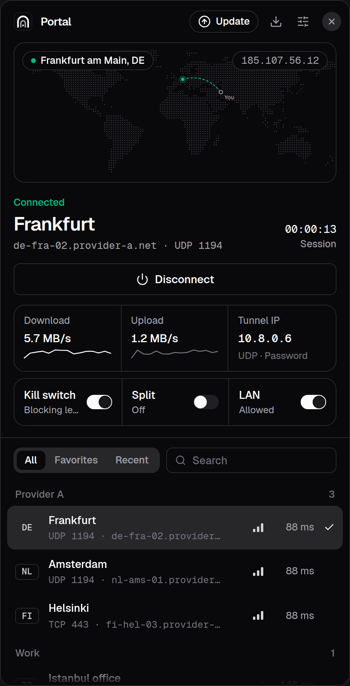
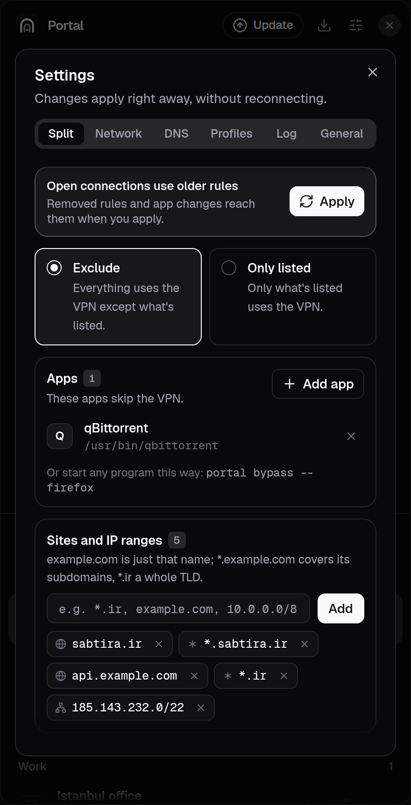
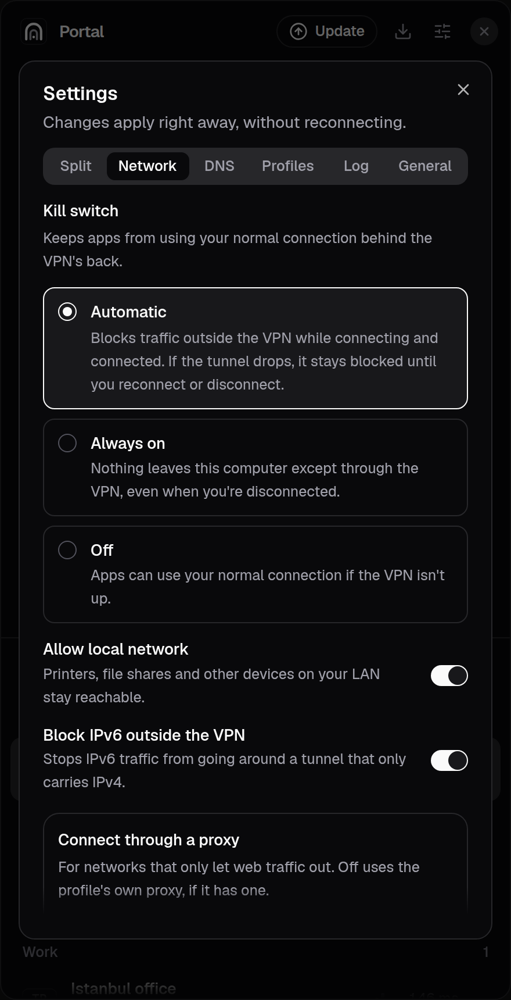

# Portal

An OpenVPN client for Linux with the conveniences of commercial VPN apps:
import your own `.ovpn` profiles, switch locations in one click, and use
split tunneling and a kill switch that apply without reconnecting.

<p align="center">
  
  
  
</p>

## Layout

```
crates/portal-core    shared types, D-Bus contract, .ovpn parser and sanitizer
crates/portald        privileged daemon: runs OpenVPN, exposes io.github.alimohammad0816.Portal.Daemon1
crates/portal-cli     `portal` command-line client
apps/desktop          Tauri 2 + React + shadcn/ui desktop app (src-tauri is the Rust side)
packaging             systemd unit, D-Bus policy, polkit actions
scripts               dev install script
```

```
desktop app / portal CLI  ──D-Bus (polkit)──►  portald (root, systemd)
                                                 └─ openvpn  ◄─ management socket
```

The GUI never runs as root. `portald` drives `openvpn` over its management
socket (state, traffic counters, credential prompts, logs) and broadcasts
`StatusChanged` / `LogLine` signals.

### Profile security

`portald` runs OpenVPN as root, so an imported profile could otherwise run
code as root. Imports are sanitized: script hooks (`up`, `down`,
`script-security`, `plugin`, ...), management and logging directives, and
anything that reads or writes an arbitrary path are rejected. Keys and
certificates must be inline; the app and CLI read referenced files as the
user and embed them before sending the profile to the daemon. The same
checks apply to a profile's extra options.

## Sign-in

Everything a server or profile can ask for is supported, and each secret
can be saved in your keyring:

- username and password, with a static one-time code (`static-challenge`);
- a passphrase for an encrypted private key (asked up front when the key is
  visibly encrypted, otherwise the first time OpenVPN needs it);
- dynamic challenges (`CRV1`, e.g. a token PIN after the password) and
  pending-auth challenges (`CR_TEXT`), answered in a dialog;
- web sign-in (`WEB_AUTH` / `OPEN_URL`), opened in your browser;
- the username and password of the proxy you connect through.

## Profiles

Import `.ovpn`/`.conf` files or a whole folder (it and its subfolders one
level deep), by drag and drop or from Settings › Profiles. Per profile you
can rename it, group it, set its country, turn off data channel offload
(DCO), and add extra OpenVPN directives (`mssfix 1400`, ...).

To reach servers from networks that only let web traffic out, set a
connection proxy (HTTP or SOCKS5, optionally with a password) in
Settings › Network, or `portal settings proxy=http://proxy.lan:3128
proxy-auth=on`. It replaces any proxy the profile names.

## Development

System packages (Ubuntu 26.04):

```bash
sudo apt install rustup build-essential pkg-config libwebkit2gtk-4.1-dev libayatana-appindicator3-dev librsvg2-dev libssl-dev libxdo-dev
```

```bash
rustup default stable
```

Run the tests:

```bash
cargo test --workspace
```

### UI only, no root

Run a simulated daemon on your session bus and point the app at it:

```bash
cargo run -p portald -- --session --mock
```

```bash
cd apps/desktop && pnpm install && PORTAL_SESSION_BUS=1 pnpm tauri dev
```

Opening `pnpm dev` in a plain browser also works: the UI falls back to
built-in sample data.

### Real connections

Install the daemon with its systemd unit, D-Bus policy and polkit actions
(asks for sudo), then start the app normally:

```bash
scripts/install-dev.sh
```

```bash
cd apps/desktop && pnpm tauri dev
```

CLI:

```bash
portal import ~/Downloads/de-fra.ovpn
```

```bash
portal connect de-fra
```

## Install

Every release has packages for amd64 (x86_64) and arm64 (aarch64). They
need systemd with systemd-resolved, and glibc 2.35 or newer.

| Distribution | File | Install |
| --- | --- | --- |
| Ubuntu 22.04+, Debian 12+, Mint, Pop!_OS | `portal_X.Y.Z_amd64.deb` / `_arm64.deb` | `sudo apt install ./portal_X.Y.Z_amd64.deb` |
| Fedora, openSUSE Tumbleweed | `portal-X.Y.Z-1.x86_64.rpm` / `.aarch64.rpm` | `sudo dnf install ./portal-X.Y.Z-1.x86_64.rpm` or `sudo zypper install ./portal-…rpm` |
| Arch, Manjaro, EndeavourOS | `portal-X.Y.Z-1-x86_64.pkg.tar.zst` | `sudo pacman -U ./portal-X.Y.Z-1-x86_64.pkg.tar.zst` |

Each package contains the app, the `portal` CLI and the `portald` service,
which starts right away. On Arch, also run
`sudo systemctl enable --now systemd-resolved`. The release's `PKGBUILD`
(with `portal.install`) builds the Arch package from the `.deb` with
`makepkg -si` and suits the AUR.

Removing: `sudo apt purge portal` removes everything, including saved
profiles. `dnf remove`, `zypper remove` and `pacman -R` keep the profiles
in `/var/lib/portald`.

There's no AppImage, Flatpak or Snap: Portal needs a root service,
D-Bus and polkit policies and firewall access, which those formats can't
install.

## Releases and updates

`.github/workflows/release.yml` runs on every `v*` tag. It builds the
`.deb` and `.rpm` on Ubuntu 22.04 for amd64 and arm64, makes the Arch
package from the amd64 `.deb`, and installs each package in fresh Ubuntu
22.04 and 24.04, Debian 12, Fedora, openSUSE Tumbleweed and Arch containers
(checking files, libraries and that the binaries start). Only when all of
them pass does it sign the packages with minisign and publish them with
`SHA256SUMS` as a GitHub release. Pushes to `main` that touch packaging run
the same builds and tests without publishing.

Each package records its format in `/usr/lib/portal/package-format`. The
app checks the latest release every few hours (it can be turned off under
Settings › General), shows an **Update** button, downloads the package for
its own format and architecture as the user, and passes it to `portald`.
The service installs it with apt, dnf, zypper or pacman, only when it is
signed with the release key in `packaging/update-key.pub`, is named
`portal`, and is newer than what's installed. The install runs in its own
systemd unit, so it survives the service restarting itself.

To publish a version:

```bash
scripts/release.sh 0.2.0
```

To let installed apps update themselves, add the contents of the minisign
secret key (`~/.config/tunnel-release/minisign.key`) as a repository secret
named `MINISIGN_SECRET_KEY`. Without it, releases are still built and can be
downloaded and installed by hand, but they're unsigned and the in-app
updater skips them. Keep that file safe: losing it means installed apps
can't verify new releases, and anyone who has it can ship updates.

## Firewall and DNS

The kill switch is one nftables table, `inet portal`, owned by `portald`
and replaced atomically on every change. While it's active, outgoing
traffic may only use the tunnel interface (`portal0`), loopback, DHCP and
neighbor discovery, the LAN (if allowed), and the daemon's own cgroup (so
OpenVPN can reach the server). While connecting, systemd-resolved may also
resolve the server's name.

- **Automatic** (default): on while connecting and connected; if the tunnel
  drops, traffic stays blocked until you reconnect or press Unblock.
- **Always on**: blocks everything outside the VPN even when disconnected.
  The table stays in place across service restarts and is removed when the
  package is removed.
- **Off**.

DNS goes through systemd-resolved: once connected, the tunnel link gets the
pushed (or your custom) servers and the `~.` routing domain. With DNS leak
protection on, port 53 and 853 are rejected everywhere except the tunnel.
IPv6 outside the tunnel can be blocked separately for IPv4-only VPNs.

From the CLI:

```bash
portal settings firewall=always lan=off dns=1.1.1.1,9.9.9.9
```

## Split tunneling

Pick apps, domains, IPs/networks and whole countries, then either
**exclude** them from the VPN (everything else uses it) or use the VPN
**only** for them. Rule changes apply to the running connection; switching
between the two modes reconnects.

| Rule | Matches |
|---|---|
| `sabtira.ir` | only `sabtira.ir` |
| `api.sabtira.ir` | only `api.sabtira.ir` |
| `*.sabtira.ir` | every subdomain (`www.sabtira.ir`, `a.b.sabtira.ir`), not `sabtira.ir` itself |
| `*.ir` | every `.ir` domain |
| `185.143.232.0/22`, `1.2.3.4` | that network or address |
| Iran (country) | every IP range registered to Iran |

For a whole site, add both `sabtira.ir` and `*.sabtira.ir`. Rules saved by
0.1.5 and earlier, where a domain also covered its subdomains, are turned
into that pair on upgrade, so they keep matching the same names.

Open connections follow added rules right away: apps keep the addresses
they already looked up, so those are split too, and connections the
change would strand are closed so their apps reconnect on the right side.
Removed rules and app changes leave working connections alone until you
press **Apply** in the split settings (or run `portal split apply`).

How it works (`crates/portald/src/split`):

- An nftables table, `inet portalsplit`, marks split packets in a
  `route` chain (so the kernel re-routes them) and masquerades them, since
  sockets pick their source address before the mark is set. Connection
  tracking keeps a flow on the side it started on.
- Policy routing sends marked packets elsewhere. Exclude: `main` without
  OpenVPN's `0/1`+`128/1` (LAN routes still apply), then a table with the
  physical gateway. Include: OpenVPN runs with `--route-noexec`, and marked
  packets use a table whose default route is the tunnel.
- Domains: systemd-resolved sends the tunnel's lookups to a small forwarder
  on `127.0.0.153`. Split names are asked on the side they'll use (so CDNs
  answer with nearby servers) and their addresses go into an nft set with a
  timeout before the answer is returned.
- Open connections: `ss -K` closes the affected sockets (never
  OpenVPN's own), which apps see as a reset.
- Apps: processes are found by executable once a second and moved into the
  `/sys/fs/cgroup/portal-split` cgroup, which the rules match.
  `portal bypass -- <command>` starts anything in it directly.
- Countries: RIR delegation lists (ipverse, ipdeny as a fallback), cached in
  `/var/cache/portald/geoip` and refreshed weekly.

```bash
portal split add '*.ir' country:IR /usr/bin/telegram-desktop
```

```bash
portal split on
```

The routing tests run against the real kernel in a throwaway network
namespace:

```bash
cargo test -p portald --no-run && unshare -rn target/debug/deps/portald-* --ignored --test-threads=1 netns
```

## Everyday conveniences

- **Saved passwords** live in your keyring (GNOME Keyring, KWallet, ...)
  through the Secret Service API. The app hands them straight to the
  service; they never reach the web view. A password the server rejects is
  forgotten, so the next attempt asks again.
- **Start at login, connect on start, connect on untrusted networks.**
  Portal watches NetworkManager's primary connection; joining a network
  that isn't on your trusted list connects the last (or chosen) location.
  Profiles with one-time codes still ask.
- **Exit location on the map**, from ipwho.is through the tunnel (can be
  turned off).
- **Proxy gateway**: one port on your LAN address speaking SOCKS5 and HTTP,
  so phones and TVs can use the VPN. It only runs while connected and only
  serves private addresses.
- **GNOME quick settings tile** (`portal@alimohammad0816.github.io`, installed with the
  package): status, recent locations, firewall and split toggles. Turn it
  on in the Extensions app, or:

```bash
gnome-extensions enable portal@alimohammad0816.github.io
```

## Roadmap

1. Done: import, connect/disconnect, location list with latency, live
   status, tray, logs, signed updates.
2. Done: kill switch, DNS leak protection, IPv6 leak blocking, allow-LAN.
3. Done: split tunneling by app, domain, IP/network and country.
4. Done: saved passwords, start at login, trusted networks, exit location,
   proxy gateway, GNOME quick settings tile.
5. Done: key passphrases, dynamic and web sign-in, connection proxy,
   folder import, DCO and extra options per profile.

## License

Portal is free software, licensed under the
[GNU General Public License v3.0 or later](LICENSE). You may use, study,
share and modify it; if you distribute a modified version, its source code
must be released under the same license.
